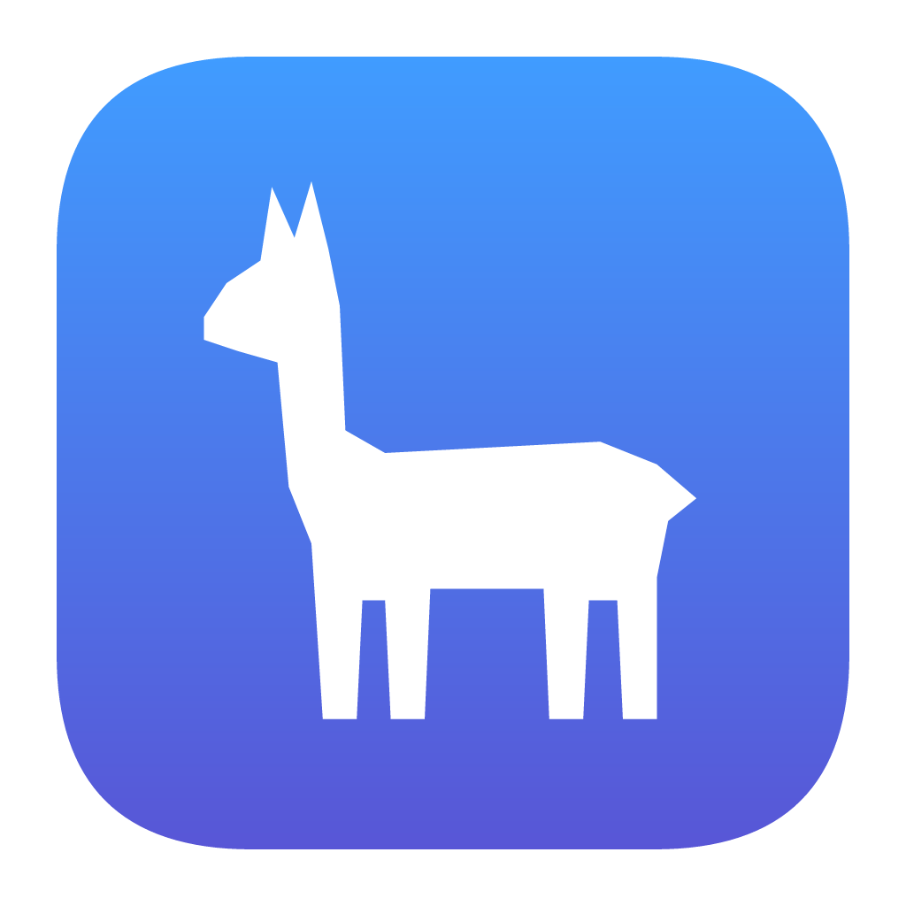
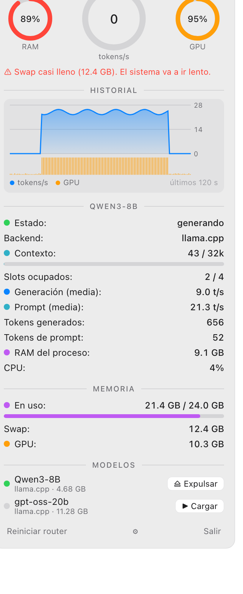
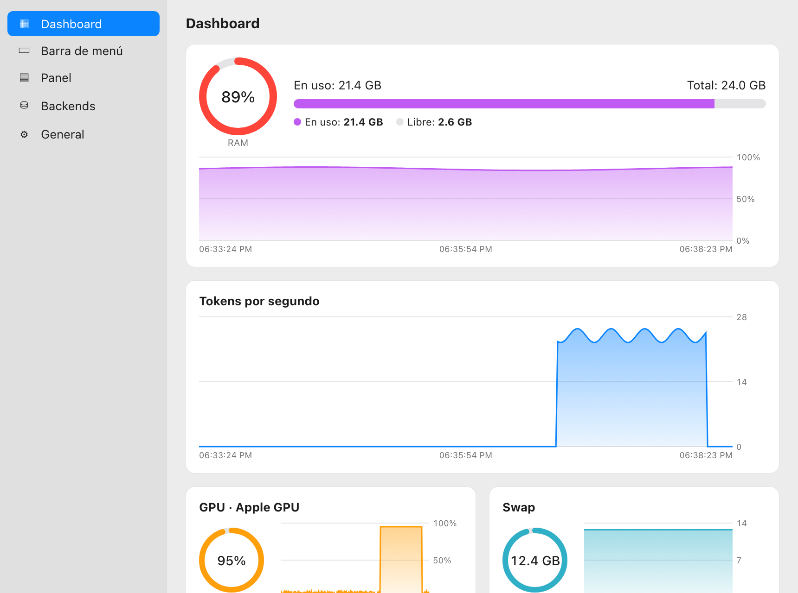

<p align="center">
  
</p>

<h1 align="center">Llamastat</h1>

<p align="center">
  <b>Mira qué están haciendo tus modelos locales, desde la barra de menú.</b><br>
  Tokens/s en vivo, contexto, RAM, GPU y swap para <a href="https://github.com/ggml-org/llama.cpp">llama.cpp</a> y <a href="https://ollama.com">Ollama</a>,
  y cargar / expulsar modelos con un clic. Para macOS, Windows y Linux.
</p>

<p align="center">
  <a href="https://llamastat.perseusoft.tech"><b>⬇ Descargar</b></a> ·
  <a href="#instalación">Instalación</a> ·
  <a href="#configurar-un-backend">Backends</a> ·
  <a href="#compilar">Compilar</a> ·
  <a href="README.md">English</a>
</p>

<p align="center">
  
  &nbsp;&nbsp;
  
</p>

---

## Para qué

Correr modelos en tu máquina está bien hasta que todo se pone lento y no sabes por qué. Llamastat te deja a un
vistazo:

- **¿Está generando y qué tan rápido?** Tokens/s en vivo, velocidad media de generación y de prompt, tokens servidos.
- **¿Qué tan lleno está el contexto?** Usado vs. tamaño de la ventana de contexto.
- **¿Cabe en memoria?** RAM del proceso del modelo, RAM del sistema, swap y memoria de GPU. Avisa cuando el swap está
  casi lleno o cuando dos backends tienen modelos cargados a la vez.
- **Libera memoria sin terminal.** Carga y expulsa modelos desde el panel.
- **Instala y elimina modelos.** Ajustes → Modelos descarga modelos de Ollama por nombre y GGUF de Hugging Face a tu carpeta de modelos de llama.cpp (añade el preset por ti); Eliminar borra el modelo y su preset.

## Funciones

| | |
|---|---|
| **Ítem en la barra / bandeja** | Eliges qué mostrar y en qué orden: ícono, tokens/s, modelo, RAM %, GPU %, contexto %, barra de RAM, gráfica de tokens/s. Monocromo o en color. |
| **Panel** | Indicadores de RAM, tokens/s y GPU, historial de 2 min, detalle de cada modelo cargado, memoria y lista de modelos con **Cargar / Expulsar**. |
| **Modelos** | Instalar (pull de Ollama, o un GGUF de Hugging Face para el router de llama.cpp) y eliminar modelos, con progreso y cancelación. El router relee sus presets al reiniciar, así que la página ofrece **Reiniciar router** tras un cambio. |
| **Dashboard** | Gráficas de 5 min de RAM, tokens/s, GPU y swap. |
| **Backends** | llama.cpp en modo router (estadísticas completas) y Ollama (memoria, contexto, keep-alive). |
| **GPU** | Apple Silicon (IOKit), NVIDIA (NVML) en Windows/Linux, AMD en Linux (sysfs). |
| **Apariencia** | Sigue el modo claro/oscuro del sistema, o fuerza uno en Ajustes → General. |
| **Idiomas** | Inglés (por defecto), español, portugués, francés, alemán, italiano, chino y japonés; sigue al sistema o se elige en Ajustes. |

## Instalación

Descarga el instalador desde **[llamastat.perseusoft.tech](https://llamastat.perseusoft.tech)** (o del [último release en GitHub](https://github.com/Perseusoft/llamastat/releases/latest)):

| Sistema | Arquitecturas | Archivo |
|---|---|---|
| **macOS** 11+ | Apple Silicon e Intel (universal) | `Llamastat_<versión>_universal.dmg` |
| **Windows** 10/11 | x64 | `Llamastat_<versión>_x64-setup.exe` o `.msi` |
| | ARM64 | `Llamastat_<versión>_arm64-setup.exe` |
| **Linux** | x64 | `.AppImage`, `.deb` (Debian/Ubuntu), `.rpm` (Fedora/openSUSE) |
| | ARM64 | `.AppImage`, `.deb`, `.rpm` |

- **macOS:** arrastra Llamastat a Aplicaciones. Mientras los builds no estén notarizados, la primera vez: clic derecho →
  **Abrir** → **Abrir** (o `xattr -dr com.apple.quarantine /Applications/Llamastat.app`).
- **Windows:** corre el `-setup.exe`. Si aparece SmartScreen: **Más información** → **Ejecutar de todas formas**.
  El texto (tokens/s, modelo…) aparece en el tooltip, porque el ícono de la bandeja es un cuadrado fijo.
- **Linux:** `sudo apt install ./llamastat_<versión>_amd64.deb`, `sudo dnf install ./llamastat-<versión>-1.x86_64.rpm`
  o el `.AppImage`. Necesita una bandeja con **AppIndicator** (en GNOME puro, la
  [extensión AppIndicator](https://extensions.gnome.org/extension/615/appindicator-support/)). El panel se abre desde
  el menú de la bandeja.

## Configurar un backend

Llamastat lee de servidores que ya tienes corriendo; no ejecuta modelos.

**llama.cpp (recomendado):** `llama-server` en modo router con `metrics = 1` en cada preset. En
[`examples/llama-router`](examples/llama-router) hay scripts para dejarlo como servicio en macOS (LaunchAgent),
Linux (systemd `--user`) y Windows (PowerShell). Ver el [README en inglés](README.md#llamacpp-recommended-full-stats)
para el ejemplo completo.

**Ollama:** no hay que configurar nada (`http://127.0.0.1:11434`). Ollama no expone contadores de tokens, así que
no hay tokens/s.

## Compilar

Necesitas [Rust](https://rustup.rs), [Node.js](https://nodejs.org) 20+ y los
[requisitos de Tauri](https://tauri.app/start/prerequisites/) de tu sistema.

```bash
git clone https://github.com/Perseusoft/llamastat.git
cd llamastat/app
npm install
npm run tauri dev      # desarrollo
npm run tauri build    # instaladores en src-tauri/target/release/bundle/
```

---

<p align="center">Hecho por <a href="https://github.com/Perseusoft">Perseusoft</a></p>
