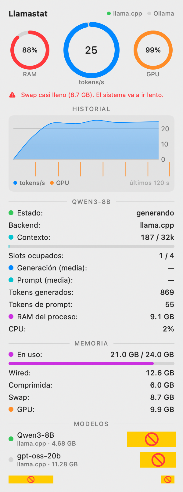

# Llamastat

Monitor de modelos locales para la barra de menú de macOS, al estilo de [Stats](https://github.com/exelban/stats).
Muestra en vivo qué modelo está cargado, tokens/s, contexto usado, RAM/GPU y swap, y permite
cargar/descargar modelos con un clic.

Backends: **llama.cpp** (router `llama-server --models-preset`) y **Ollama**.



## Qué mide

| Métrica | De dónde sale |
|---|---|
| tokens/s en vivo | `/slots` (tokens decodificados en curso) + `/metrics` (acumulados) |
| Media de generación / prompt | `/metrics`: tokens totales ÷ segundos totales |
| Contexto usado / tamaño | `/slots` (`n_prompt_tokens`, `n_ctx`) |
| RAM y CPU del modelo | proceso `llama-server` del modelo (`proc_pid_rusage`) |
| GPU % y memoria GPU | IORegistry `IOAccelerator` → `PerformanceStatistics` (sin root) |
| RAM, wired, comprimida, swap | `host_statistics64`, `vm.swapusage` |
| Ollama | `/api/tags`, `/api/ps` (VRAM, contexto, cuándo se descarga). Sin contadores de tokens. |

Avisa cuando hay modelos cargados en dos backends a la vez o el swap está casi lleno.

En llama.cpp, `/metrics` necesita `metrics = 1` en cada preset (ver `stack/models/presets.ini`).

## Compilar

Requiere macOS 14+ y Xcode (los macros de SwiftUI no vienen en Command Line Tools).

```bash
./scripts/build-app.sh            # build/Llamastat.app
./scripts/build-app.sh --install  # copia a ~/Applications y la abre
```

`Llamastat --snapshot out.png` renderiza el popover a una imagen tras ~8 s de muestreo.

## `stack/`: mi setup de llama.cpp

| Ruta | Qué es | Se instala en |
|---|---|---|
| `stack/models/presets.ini` | Modelos del router | `~/models/presets.ini` (symlink) |
| `stack/launchd/com.local.llama-router.plist` | LaunchAgent del router (:8080) | `~/Library/LaunchAgents/` (copia) |
| `stack/xbar/llamacpp.10s.sh` | Plugin xbar anterior (reemplazado por la app) | — |
| `stack/install.sh` | Enlaza lo anterior y reinicia el router | — |
| `stack/start.sh` | Levanta router + lista modelos | — |

```bash
brew install llama.cpp
./stack/install.sh
```

- OpenAI-compatible: `http://localhost:8080/v1`
- Anthropic-compatible: `http://localhost:8080/v1/messages`

Notas: con 24 GB no correr dos modelos de ~20B a la vez (`--models-max 1`); los modelos se
descargan tras 15 min sin uso (`--sleep-idle-seconds 900`).
